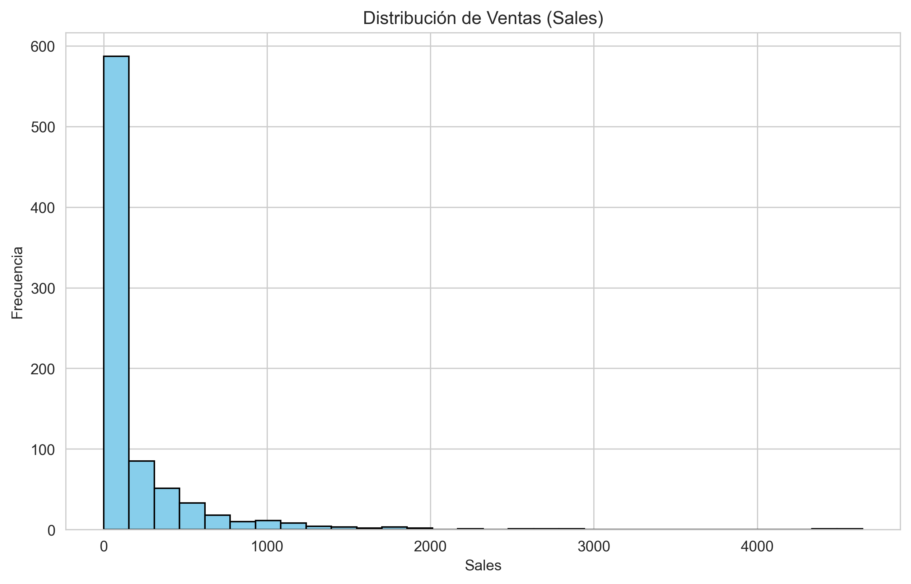
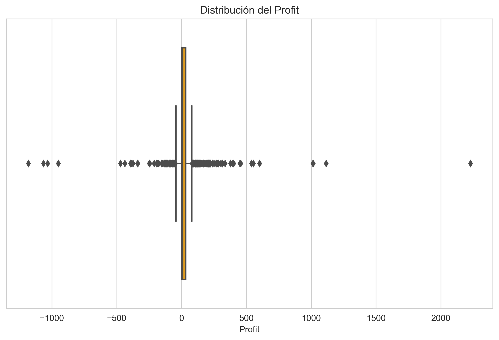
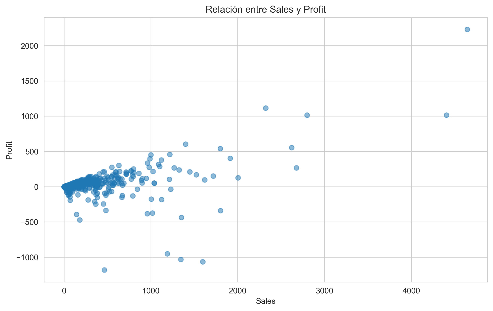
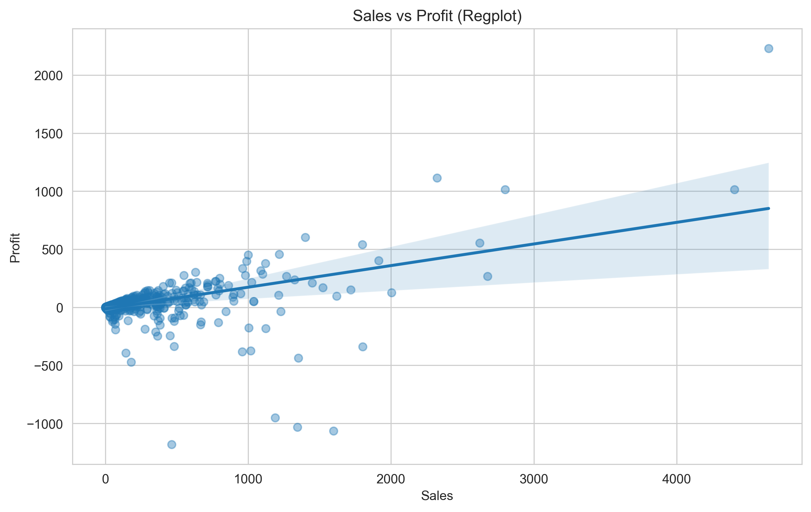
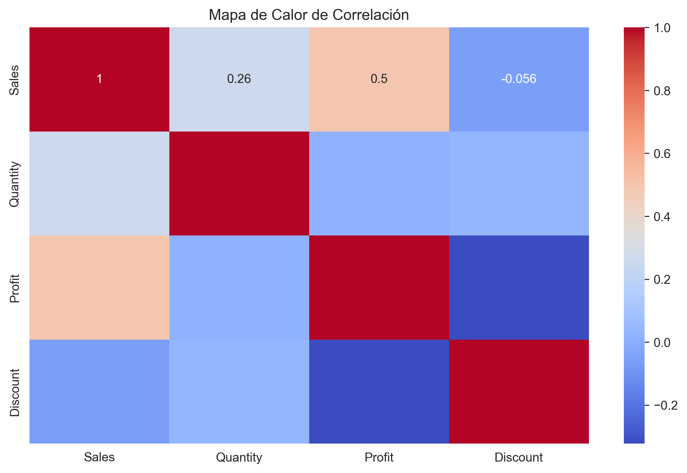
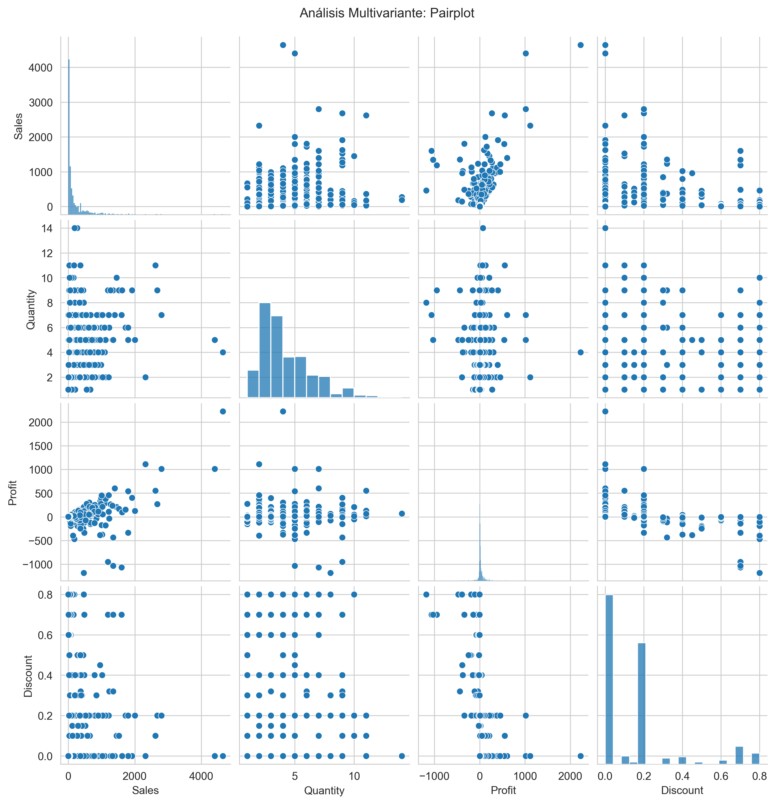
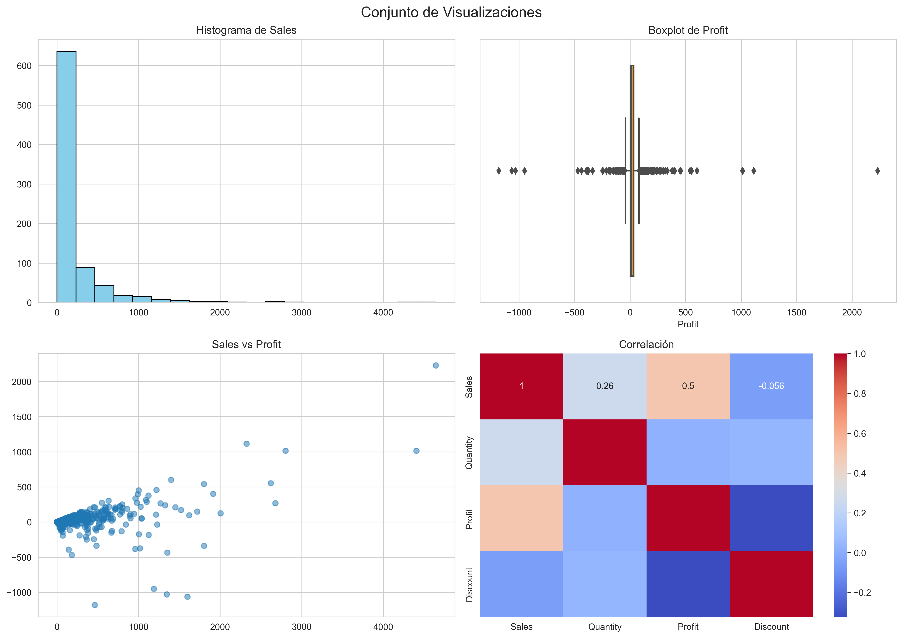
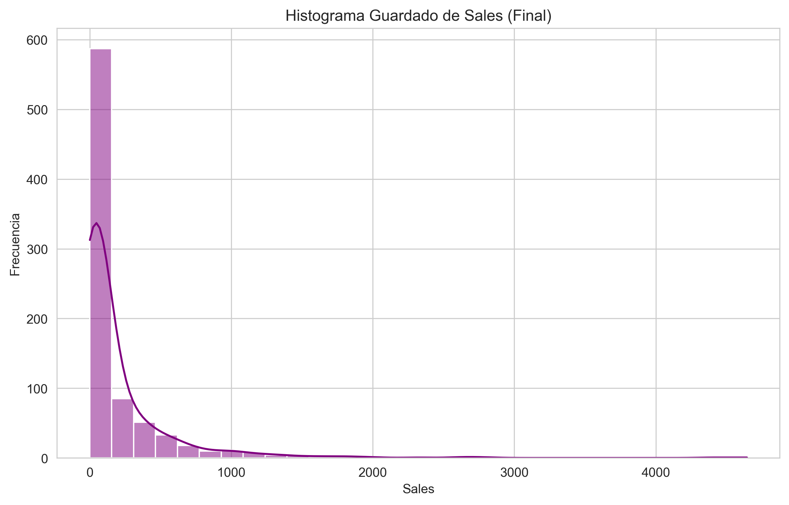

# Retail Visualizations — Matplotlib / Seaborn

A historical chart-generation exercise reading a bundled Superstore CSV with
Pandas and saving sales/profit distributions, relationships and multivariate
views. The PNG gallery below is actual repository output, not an interactive or
hosted dashboard.

[Engineering portfolio](https://github.com/miguelcastu/miguelcastu) · [Project directory](https://github.com/miguelcastu/miguelcastu/blob/main/PROJECTS.md)

## Run locally

With Python, Pandas, Matplotlib and Seaborn installed, run from this repository root:

```shell
python Dashboards.py
```

The script reads `superstore_dataset2012.csv`, saves figures in the working
directory and calls `plt.show()`. It can overwrite generated PNGs; use a disposable
copy for reproduction. Package versions are not locked and regeneration was not
verified in this audit. Confirm dataset and image redistribution rights before
republishing them outside the original repository.

## Existing visualization gallery


# 📈 Superstore Data Visualization Dashboard

This project generates a comprehensive set of visualizations using the **Superstore 2012** dataset and the libraries **Matplotlib** and **Seaborn**.  
All figures are automatically saved as PNG files and included in the repository.

---

## 📊 Visualizations Included

### ✔ Univariate Analysis (Matplotlib)
#### Histogram – Sales  


---

### ✔ Univariate Analysis (Seaborn)
#### Boxplot – Profit  


---

### ✔ Bivariate Analysis (Matplotlib)
#### Scatter Plot – Sales vs Profit  


---

### ✔ Bivariate Analysis (Seaborn)
#### Regplot – Sales vs Profit  


---

### ✔ Multivariate Analysis
#### Correlation Heatmap  


#### Pairplot – Sales, Quantity, Profit & Discount  


---

### ✔ Dashboard (Subplots)
A 2×2 layout combining histogram, boxplot, scatter, and heatmap:



---

### ✔ Additional Visualization
#### Final Histogram (Seaborn)


---

## 📦 Project Files
- `Dashboards.py` — main script that generates all figures  
- `superstore_dataset2012.csv` — dataset used for the analysis  
- PNG visualizations stored in the repository root  

---

## ▶️ Requirements & How to Run

```bash
pip install pandas numpy matplotlib seaborn
python Dashboards.py
```
